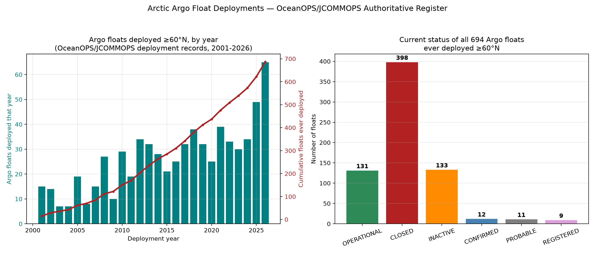

# Arctic Argo Floats — The Authoritative OceanOPS/JCOMMOPS Register

This checks marine/ocean observing statistics directly from the Argo program's own
data centers, as requested: **OceanOPS** (formerly JCOMMOPS, the WMO-IOC monitoring
and coordination centre for Argo and the other GOOS in-situ networks, at
[ocean-ops.org](https://www.ocean-ops.org)). This is a better source for Argo
specifically than OSCAR's own "Underwater (mobile)" register used in
[ARCTIC_MARINE_OSCAR_REGISTRY.md](ARCTIC_MARINE_OSCAR_REGISTRY.md), because
OceanOPS is the Argo program's actual metadata authority (OSCAR ingests a copy of
some of this, with the registration-date problems documented in that report).

## Method and data source

OceanOPS exposes a public (undocumented, "deprecated test version" per the
project's own `oceanjson` GitHub repo) JSON API at
`https://www.ocean-ops.org/api/data/oceanjson/platforms`. Pulling all 87,092
platform records it holds (paginated at 1,000/request) and filtering to programs
whose name contains "Argo" (69 distinct national/regional Argo programs, e.g.
"Argo NORWAY", "Argo BSH" [Germany], "Argo UW", "Euro-Argo") gives **22,393 Argo
floats registered worldwide**, of which **694 have a deployment position at or
north of 60°N**. Each record includes a genuine deployment date, deployment
position, program/country, and current reporting status — unlike the OSCAR mobile-
platform dates flagged as unreliable in the companion report, these deployment
dates are the Argo program's own historical deployment log and can be trusted for
a time series.

Data file: [oceanops_argo_arctic_floats.csv](oceanops_argo_arctic_floats.csv)
(694 floats, ref/program/country/status/deployment date/position)

**Caveat:** this uses *deployment* position, not current/last-known position —
Argo floats drift freely with ocean currents for their multi-year mission, so a
float deployed just south of 60°N could later drift north (or vice versa). It's
the best field available from this lightweight endpoint, and is directly
comparable to how we treated IABP buoy and land-station data elsewhere in this
folder (deployment/establishment-based counting).

## How big is Arctic Argo, really?

Only **694 of 22,393 Argo floats ever deployed worldwide (3.1%) have gone into
Arctic waters (≥60°N)**. Argo is overwhelmingly a mid-latitude and tropical/open-
ocean program; the Arctic (seasonally ice-covered, logistically difficult, and
requiring floats with special under-ice parking/ice-avoidance firmware) remains a
small niche of the overall fleet.

## Deployment trend: real, recent, and accelerating

Unlike the flat-to-declining signals found elsewhere in this folder (land stations
plateauing since ~2020, IABP buoy counts declining since 2020), **Arctic Argo
deployment has been climbing and has accelerated sharply in the last two years**:

| Period | Floats deployed ≥60°N |
|---|---|
| 2001-2010 (10 yrs) | 151 |
| 2011-2020 (10 yrs) | 286 |
| 2021-2024 (4 yrs) | 136 |
| **2025** | **49** |
| **2026** (year still in progress) | **65** |

2025 and 2026 alone account for 114 deployments — more than any single prior
decade shown above once annualized (151/10 ≈ 15/yr and 286/10 ≈ 29/yr vs. 49-65
in single recent years). This is consistent with the WMO/IOC GOOS 2025 status report's observation
(cited in [ARCTIC_MARINE_OBSERVATIONS_AND_SHIP_DATA.md](ARCTIC_MARINE_OBSERVATIONS_AND_SHIP_DATA.md))
that growth in autonomous networks like Argo has been offsetting declines
elsewhere in the ocean observing system — here we can see that growth
concretely reaching the Arctic specifically, not just globally. 7 further floats
are already CONFIRMED/PROBABLE for deployment in 2027.

## But most deployed floats are no longer active

Of the 694 floats ever deployed ≥60°N:

| Status | Count |
|---|---|
| CLOSED | 398 (57%) |
| INACTIVE | 133 (19%) |
| **OPERATIONAL** | **131 (19%)** |
| CONFIRMED (planned) | 12 |
| PROBABLE (planned) | 11 |
| REGISTERED | 9 |

Only 131 (19%) are currently Operational — expected, since Argo floats have a
limited mission life (typically ~4-5 years of battery/profiling cycles before
they're lost or decommissioned), so a large historical "Closed" pile is normal for
this platform type, the same point made about OSCAR's own mobile-platform
register. The recent deployment surge (2025-2026) means many of today's 131
Operational floats are quite new.

## Geographic concentration: the Nordic/European Arctic, not the high Arctic basin

| Country (lead agency) | Arctic Argo floats deployed |
|---|---|
| Germany | 134 |
| United States | 114 |
| Norway | 109 |
| United Kingdom | 79 |
| France | 75 |
| Canada | 45 |
| Finland | 41 |
| Poland | 33 |
| European Union (Euro-Argo) | 31 |
| Denmark | 17 |

By latitude band: 356 of 694 (51%) were deployed at ≥70°N, but only 65 (9%) at
≥78°N and 49 (7%) at ≥80°N — Argo deployment is concentrated in the Nordic Seas,
Barents Sea, and Fram Strait (ice-free or seasonally ice-free water accessible to
research vessels), not the permanently ice-covered central Arctic Ocean basin,
mirroring the same basin-vs-periphery pattern found for land stations and IABP
buoys throughout this folder.

## Cross-check against OSCAR's own count

OSCAR's "Underwater (mobile)" category (≥60°N, all statuses) showed **731**
platforms in
[ARCTIC_MARINE_OSCAR_REGISTRY.md](ARCTIC_MARINE_OSCAR_REGISTRY.md), with 204
Operational — both numbers are in the same order of magnitude as OceanOPS's 694
total / 131 Operational, but not identical, because OSCAR's figure mixes
deployment-time and current/registration-time positions inconsistently (the dates
shown to be unreliable in that report), while OceanOPS gives a clean deployment-
based count. The two sources agree on the big picture — a few hundred Arctic Argo
floats, a small fraction of each registry's global total — even though they
disagree on the precise count, which is itself a useful illustration of why
cross-checking against the Argo program's own authoritative data center (OceanOPS)
is worth doing rather than relying on OSCAR alone for this platform type.
