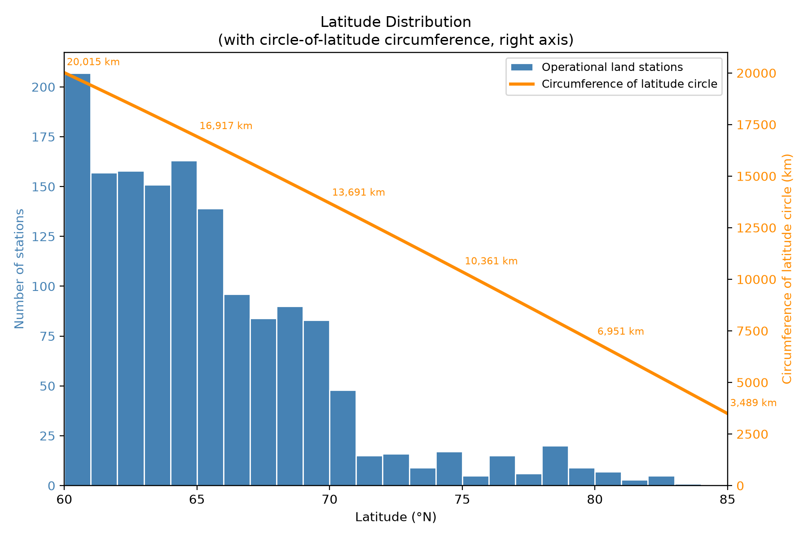
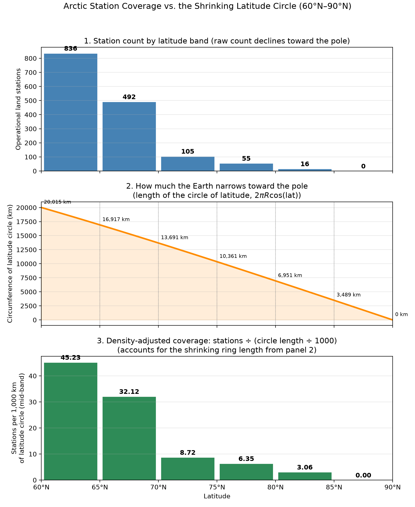

# Why Raw Latitude Histograms Understate How Empty the High Arctic Is

The "Latitude Distribution" and "Distribution by Latitude Band" panels in
[oscar_arctic_stations_comprehensive.png](oscar_arctic_stations_comprehensive.png)
(and the equivalent tables throughout this folder) show station *counts* per
degree or per 5°-latitude band. Those counts are easy to misread, because a
5°-latitude band doesn't represent the same amount of actual ground everywhere:
the circle of latitude you're slicing gets dramatically shorter as you approach
the pole.

## The geometry

The length of the circle of latitude at latitude φ is:

```
circumference(φ) = 2 π R cos(φ)      (R = Earth's mean radius ≈ 6,371 km)
```

This goes from the full ~40,075 km circumference at the equator down to **0 km
exactly at the pole**, and the decline is not linear — it accelerates as φ
approaches 90°:

| Latitude | Circumference of that circle of latitude |
|---|---|
| 60°N | 20,015 km |
| 65°N | 16,917 km |
| 70°N | 13,691 km |
| 75°N | 10,361 km |
| 80°N | 6,951 km |
| 85°N | 3,489 km |
| 90°N | 0 km |

So the ring at 80°N is already only about a third the length of the ring at 60°N,
and the ring at 85°N is under a fifth.

## Updated latitude-distribution histogram with the circle length overlaid

This directly updates the "Latitude Distribution" panel (top-middle panel of
[oscar_arctic_stations_comprehensive.png](oscar_arctic_stations_comprehensive.png)),
adding the circle-of-latitude circumference as a secondary (right-hand) axis so
both curves can be read off the same chart:



Same 1°-wide latitude bins and 60-85°N range as the original panel (using the
corrected, comprehensive Operational land-station counts from
[oscar_arctic_land_stations_allstatus_60n.csv](oscar_arctic_land_stations_allstatus_60n.csv)).
The blue bars (left axis) are the station count per degree of latitude; the
orange line (right axis) is the circumference of the circle of latitude at that
degree. Visually, the bar heights fall off a bit faster than the orange line
through about 70°N, then both are low — which is exactly what the
density-adjustment below quantifies.

## Putting it next to the station counts (band view)



Data: [latitude_circle_length_by_band.csv](latitude_circle_length_by_band.csv)
(uses the corrected, comprehensive Operational land-station counts from
[oscar_arctic_land_stations_allstatus_60n.csv](oscar_arctic_land_stations_allstatus_60n.csv))

- **Panel 1** reproduces the familiar declining station-count-by-band histogram
  (836 → 492 → 105 → 55 → 16 → 0 stations per 5° band from 60°N to 90°N).
- **Panel 2** is the geometric fact requested here: the latitude circle shrinks
  from 20,015 km down to 0 km over the same range, non-linearly (it's a cosine
  curve, so it falls slowly at first and very steeply near the pole).
- **Panel 3** divides the two — stations per 1,000 km of the latitude circle at
  the middle of each band — to ask whether the apparent High Arctic "gap" is just
  an artifact of slicing a shrinking ring into equal-sized degree bands.

## The gap is real, not a counting artifact

A natural hypothesis going in was that correcting for the shrinking ring might
make the High Arctic look better-covered than the raw counts suggest. **It
doesn't.** Density-adjusted coverage still falls sharply toward the pole:

| Band | Stations | Circle length (mid-band) | Stations per 1,000 km of circle |
|---|---|---|---|
| 60-65°N | 836 | 18,484 km | **45.2** |
| 65-70°N | 492 | 15,319 km | **32.1** |
| 70-75°N | 105 | 12,037 km | **8.7** |
| 75-80°N | 55 | 8,664 km | **6.3** |
| 80-85°N | 16 | 5,225 km | **3.1** |
| 85-90°N | 0 | 1,746 km | **0.0** |

Density per 1,000 km of latitude circle drops by roughly 5x between the
60-65°N band and the 70-75°N band — a much bigger drop than the shrinking ring
alone would cause (the ring itself only shrinks by ~35% over that same range). So
the High Arctic really is sparser in relative, not just absolute, terms — this
reinforces the "critical High Arctic monitoring gap" conclusion in
[WMO_OSCAR_ARCTIC_ANALYSIS.md](WMO_OSCAR_ARCTIC_ANALYSIS.md) and
[ARCTIC_STATION_NETWORK_EVOLUTION_1980-PRESENT.md](ARCTIC_STATION_NETWORK_EVOLUTION_1980-PRESENT.md)
rather than explaining it away.

**Caveat:** "stations per 1,000 km of latitude circle" is a linear (ring-length)
density, not an areal one. Degrees of latitude are close to a constant ~111 km
apart everywhere (meridians are great circles), so a proper area-based density
(stations per km²) would tell essentially the same story — the circumference term
is what varies by an order of magnitude across these bands and dominates the
comparison either way.
