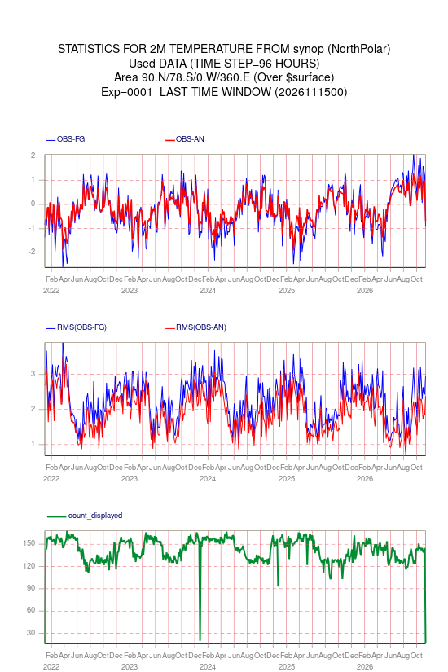
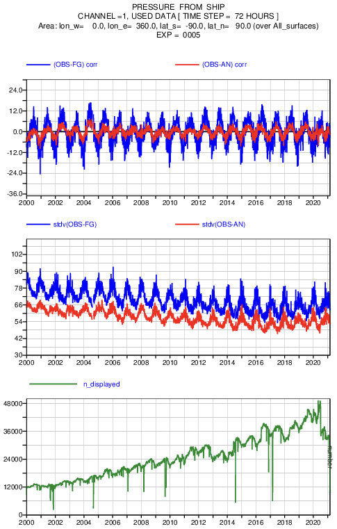
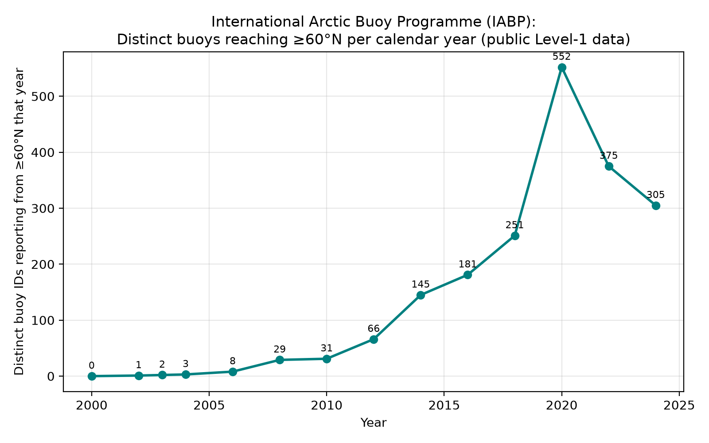

# Marine Observations and the "More Registered Stations, Fewer Assimilated Observations" Paradox

This follow-up extends
[ARCTIC_STATION_NETWORK_EVOLUTION_1980-PRESENT.md](ARCTIC_STATION_NETWORK_EVOLUTION_1980-PRESENT.md)
to the **marine side** of the Arctic observing system. The Arctic is mostly ocean,
so land-based SYNOP stations (the focus of the rest of this folder) are only part
of the picture — ships and sea-ice buoys matter a great deal more here than in
most other regions. Two ECMWF observation-monitoring charts motivated this
analysis and are reproduced below for reference.

## Chart 1: real-time 2m-temperature observations actually used, North Polar cap

*"STATISTICS FOR 2M TEMPERATURE FROM synop (NorthPolar)", area 90°N/78°N, all
longitudes, 96-hour window. `count_displayed` (bottom panel) is the number of
observation–model comparison pairs ECMWF's monitoring actually used.*

Cross-referencing this domain (≥78°N) against our own
[oscar_arctic_stations_60n.csv](oscar_arctic_stations_60n.csv) (with the 14 Bosnia
and Herzegovina test stations excluded, see the evolution report) shows **only 31
land stations are OSCAR-registered there at all** (17 Norway, 6 Canada, 5 Russia, 3
Greenland), and **16 of those 31 (52%) are assessed "Unknown," "Partly
operational," or "Silent."** That is consistent with the chart's `count_displayed`
sitting around 120–160 early on and drifting down toward 90–130 with occasional
sharp dips later — a small, maintenance-fragile candidate pool to begin with, where
losing a handful of stations swings the total noticeably. See the main evolution
report for the broader explanation (OSCAR metadata growth vs. real GTS delivery,
and the well-documented post-2022 reduction in Russian Arctic data reaching the
international network).

## Chart 2: the global ship-pressure picture — and why it doesn't carry over to the Arctic

*"PRESSURE FROM SHIP", area 90°S/90°N, all longitudes, 72-hour window. `n_displayed`
(bottom panel) grows roughly 4x, from ~12,000 to ~48,000, between 2000 and 2020.*

This looks like strong growth in marine observations — but two things limit how
much it tells us about the Arctic specifically:

1. **It's a global total**, dominated by the major commercial shipping lanes
   (North Atlantic, North Pacific, Suez, Panama, Indian Ocean) that the Voluntary
   Observing Ship (VOS) fleet already sails — not new coverage of previously
   unobserved ocean, let alone the ice-covered Arctic Ocean.
2. **The growth is a reporting-frequency effect, not a fleet-size effect.** Per the
   WMO/IOC Global Ocean Observing System (GOOS) 2025 status report, VOS achieved a
   record ~4.5 million observations in 2024 "supported by an increase in
   automation — **but the number of ships involved is decreasing**"
   ([ocean-ops.org/goosreport](http://ocean-ops.org/goosreport)). Automated
   transmission lets each participating ship report far more often than the
   historical few-times-a-day manual logbook entries, inflating `n_displayed`
   while the underlying number of vessels shrinks.

Routine merchant shipping essentially does not enter the Arctic Ocean outside a
short summer season on the Northern Sea Route / Northwest Passage, so this chart's
growth curve should **not** be read as evidence that marine data coverage of the
Arctic has improved.

## What actually observes the Arctic Ocean: drifting sea-ice buoys

The Arctic Ocean's real in-situ marine network is the **International Arctic Buoy
Programme (IABP)** — drifting buoys deployed on sea ice and in open water,
reporting pressure, temperature, and ice drift, with an average buoy lifespan of
only ~18 months before replacement (via aircraft or icebreaker). NOAA cites a
target of "less than 250 km spacing" (~200+ buoys) and reported **228 buoys
active north of 60°N in September 2024**
([NOAA Global Ocean Monitoring](https://globalocean.noaa.gov/project/coordination-and-data-management-of-the-u-s-interagency-arctic-buoy-program-iabp/)).

To get an actual multi-decade trend rather than a single snapshot, I downloaded
IABP's public "Level-1" per-year bulk data
(`https://iabp.apl.uw.edu/downloadL1?year=YYYY&requesttype=yeardump`) for 13
sample years (2000, 2002, 2003, 2004, 2006, 2008, 2010, 2012, 2014, 2016, 2018,
2020, 2022, 2024) and counted **distinct buoy IDs that reported from ≥60°N at
least once that calendar year** (filtering out a small number of invalid/sentinel
GPS fixes, e.g. exact -90° or out-of-range values):

| Year | Distinct buoys reporting from ≥60°N |
|---|---|
| 2000 | 0 |
| 2002 | 1 |
| 2003 | 2 |
| 2004 | 3 |
| 2006 | 8 |
| 2008 | 29 |
| 2010 | 31 |
| 2012 | 66 |
| 2014 | 145 |
| 2016 | 181 |
| 2018 | 251 |
| 2020 | 552 |
| 2022 | 375 |
| 2024 | 305 |

Data file: [iabp_arctic_buoy_counts_by_year.csv](iabp_arctic_buoy_counts_by_year.csv)

**Caveats on this series** (important — this was reconstructed from a public bulk
download, not an audited statistic):
- The near-zero counts in 2000–2004 almost certainly reflect **this specific
  digital bulk-download pipeline ramping up**, not literally 0–3 physical buoys —
  IABP's buoy network dates to 1979 and historical counts from other sources are
  higher even in the early 2000s. Treat the pre-2008 values as a lower bound /
  pipeline-coverage artifact, not an absolute count.
- "Distinct buoys reporting in a calendar year" is **not the same statistic** as
  NOAA's "228 buoys active on a given day" — because buoys last ~18 months, more
  distinct buoys cycle through over a full year than are active on any single day,
  which is why our 2020–2024 figures (552, 375, 305) run higher than the ~228
  "currently active" figure quoted for 2024. The two numbers aren't directly
  comparable, but the **trend** (rise, peak, decline) should still be meaningful
  since the same counting method was applied to every year.
- I could not access an authoritative, continuous historical "buoys active per day"
  series to cross-check this reconstruction; it should be treated as directional
  evidence, not a definitive count.

With those caveats, two things stand out:
1. **Real, substantial growth 2000 → 2020** — this is a genuine expansion of
   Arctic in-situ marine sensing capacity, unlike the global ship chart's
   automation-driven growth.
2. **A clear decline after the 2020 peak** (552 → 375 → 305), which plausibly
   reflects a combination of: COVID-19-era disruption to the aircraft/icebreaker
   logistics needed to deploy and replace buoys (2020–2022), and reduced
   international data-sharing from Russia (a major historical Arctic buoy
   deployer, via AARI) since February 2022 — the same mechanism already
   documented for Russian land-station data in the main evolution report. This
   attribution is plausible but **not confirmed** from this data source alone,
   since buoy nationality/operator isn't included in the bulk per-observation file.

## Synthesis

Putting all three threads together:

- **Land stations**: OSCAR registration counts keep growing, but the fraction
  actually delivering usable real-time data to ECMWF is roughly flat-to-declining
  in the high Arctic, and Russia (the single largest contributor) shows no new
  OSCAR registrations since the 1990s while international delivery of its data has
  been disrupted since 2022.
- **Ships**: the striking global growth in ship-pressure observations is a
  mid-latitude, automation-driven trend that essentially bypasses the Arctic Ocean
  and should not be used as evidence of improving Arctic marine coverage.
- **Buoys**: the IABP drifting-buoy network — the Arctic Ocean's actual marine
  observing backbone — did grow substantially from the early 2000s through 2020,
  but our reconstruction suggests a real pullback since then.

None of the "more observations" headline numbers people usually reach for (OSCAR
station counts, global VOS growth) straightforwardly support the idea that
real-time Arctic observational input to weather forecasting has been increasing.
The buoy network is the one piece of evidence here for genuine historical growth
in Arctic-specific in-situ capacity, and even that shows signs of recent
contraction.

## Recommended follow-up (needs data we don't have access to here)

- An **Arctic-domain-restricted** version of the ship/buoy ECMWF monitoring chart
  (same `90°N/78°N`-style bounding box as Chart 1, but for marine obs) would let us
  test the IABP-based hypothesis above directly against what ECMWF's data
  assimilation actually ingests.
- An authoritative, audited IABP "buoys active per day" time series (rather than
  our calendar-year bulk-file reconstruction) would validate or correct the trend
  shown above.
- Buoy metadata with deploying organization/country would let us test the
  "post-2022 Russian contribution decline" hypothesis directly, the same way we
  could for land stations.
