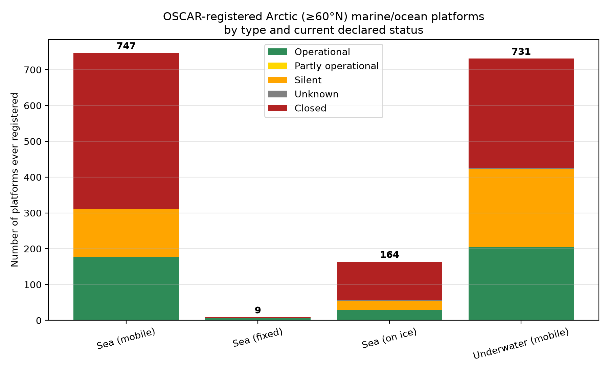

# The Marine/Ocean Side of OSCAR's Arctic Register

This complements
[ARCTIC_STATION_NETWORK_EVOLUTION_1980-PRESENT.md](ARCTIC_STATION_NETWORK_EVOLUTION_1980-PRESENT.md)
(land stations) and
[ARCTIC_MARINE_OBSERVATIONS_AND_SHIP_DATA.md](ARCTIC_MARINE_OBSERVATIONS_AND_SHIP_DATA.md)
(external IABP buoy reconstruction + ECMWF ship-chart discussion) by looking at what
OSCAR *itself* has registered for ships, drifting ice buoys, and profiling floats
north of 60°N. All data pulled directly from the OSCAR API
(`latitudeMin=60&latitudeMax=90&longitudeMin=-180&longitudeMax=180`), the same
query used for the corrected land-station analysis.

## What's registered

| Platform type | Ever registered (≥60°N) | Operational now | Closed | Silent | Other |
|---|---|---|---|---|---|
| Sea (mobile) — ships/surface drifters | 747 | 177 | 436 | 134 | 0 |
| Underwater (mobile) — Argo profiling floats | 731 | 204 | 306 | 218 | 3 |
| Sea (on ice) — drifting ice buoys | 164 | 30 | 108 | 24 | 2 |
| Sea (fixed) — moored buoys | 9 | 6 | 3 | 0 | 0 |
| **Total** | **1,651** | **417** | **853** | **376** | **5** |

Data file: [oscar_arctic_marine_platforms_allstatus_60n.csv](oscar_arctic_marine_platforms_allstatus_60n.csv)

A few things jump out immediately:

- **Over half (853 of 1,651, 52%) of everything ever registered is now Closed.**
  This is structurally different from land stations (only 91 of 1,621, 5.6%,
  closed) — mobile/drifting platforms have short, consumable lifespans (an Argo
  float or drifting buoy typically lasts a few years before its battery dies or it
  's recovered/lost), so a large historical "Closed" pile is expected and normal,
  not necessarily a sign of network decline the way land-station closures are.
- **"Underwater (mobile)" is Argo floats, not weather stations.** These measure
  subsurface ocean temperature/salinity profiles, not surface meteorological
  variables, so they aren't inputs to the kind of SYNOP 2m-temperature or
  ship-pressure assimilation shown in the ECMWF charts in the companion marine
  report. They matter for ocean/climate monitoring, but shouldn't be counted
  alongside ships and buoys as "more weather observations."
- **"Sea (mobile)" is dominated by Scripps (SIO-DB) and NOAA (AOML) drifter
  programs and VOS-US** — global drifter-buoy and ship programs that happen to
  pass through ≥60°N occasionally, not Arctic-dedicated assets. This is the OSCAR
  mirror of the point made in the companion marine report: growth in global
  drifter/VOS programs doesn't equal growth in Arctic-specific coverage.

## Cross-checking the IABP drifting-ice-buoy estimate

The "Sea (on ice)" category (drifting buoys on or in sea ice) is the OSCAR
equivalent of the external IABP reconstruction done in the companion report. Its
breakdown by program is informative:

| Program tag | Count |
|---|---|
| EC DB (Environment Canada) | 53 |
| E-SURFMAR (EUMETNET) | 51 |
| IABP US | 43 |
| IABP (generic) | 10 |
| UK-MO DB | 3 |
| EC-IABP | 2 |
| Argo CANADA eq. | 2 |

Only **~53 of the 164 Sea-on-ice records (32%) are explicitly tagged "IABP"** —
NOAA separately states the IABP network itself had **228 buoys active north of
60°N as of September 2024**. OSCAR's own registry is therefore capturing roughly a
**quarter** of IABP's actual fleet at best, because most national contributions to
the international IABP consortium (notably historically important Russian AARI
buoys) are registered under other national program tags, or not individually
registered in OSCAR at all. This is the same fragmentation problem documented for
land stations, but worse for marine platforms: **OSCAR's marine register is not a
reliable census of the Arctic's actual in-situ ocean/ice observing capacity**, only
of what's been voluntarily entered into this particular metadata system.

## Why we did not build a time-evolution chart for marine platforms

Unlike land stations (where `dateEstablished` reliably reflects genuine historical
founding dates back to the 1700s–1800s), the mobile-platform dates in OSCAR look
like **metadata-registration timestamps**, not real deployment dates. Direct
evidence from the IABP-tagged "Sea (on ice)" records:

| Buoy ID | Status | Date established (OSCAR) | Date closed (OSCAR) |
|---|---|---|---|
| 2501547 | Closed | 2026-05-27 | 2026-02-25 |
| 2501548 | Closed | 2025-08-18 | 2024-12-15 |
| 2501551 | Closed | 2026-01-20 | 2025-10-21 |

In every one of these, **the recorded closure date is *before* the recorded
establishment date** — impossible for a real deployment, but consistent with
`dateEstablished` actually meaning "when this WIGOS record was created/bulk-loaded
into OSCAR" (clustered almost entirely in 2025–2026) while `dateClosed` retains the
buoy's genuine decommission date from the contributing program's own records.
Building a "stations established per decade" chart from these dates, the way we
did for land stations, would therefore be meaningless — it would just show a wall
of fake "establishments" in 2025–2026. This is why the companion marine report
instead reconstructed a real buoy-count trend from IABP's own per-observation bulk
data rather than from OSCAR's station metadata.

## Bottom line

OSCAR's own marine/ocean registry reinforces, rather than changes, the conclusions
of the companion marine report:

1. It confirms the **fragmentation** story — OSCAR captures only a fraction
   (roughly a quarter, by the IABP comparison above) of the real international
   Arctic buoy fleet, spread thinly across many separately-tagged national
   programs.
2. It confirms that **mobile marine/ice platforms have fundamentally different
   lifecycle dynamics** than land stations (majority-Closed is normal and expected,
   not a sign of network collapse), so the land-station "true evolution" analysis
   method doesn't transfer to this data.
3. It reinforces that counting "more platforms ever registered" (1,651 marine
   platforms, or even just "Operational" 417) says very little about how much
   *current, real-time, Arctic-specific* ocean/ice observational capacity exists —
   the same registration-vs-reality gap documented for land stations throughout
   this folder.
