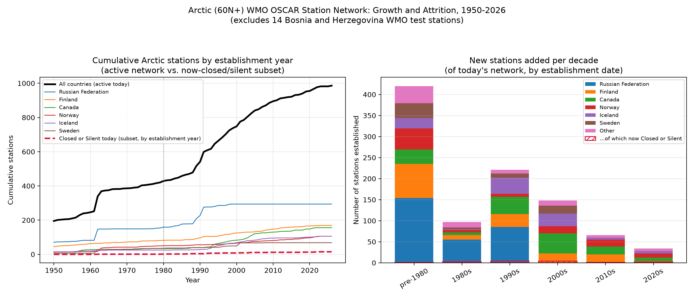

# How Has the Arctic Station Network Evolved from the 1980s to Now?

This supplements the earlier WMO OSCAR analysis in this folder, which described the
**current (2026) snapshot** of the Arctic (60°N+) station network but did not address
how that network changed over time. This report uses the `Date established` /
`Date closed` / `Assessed reporting status` fields in
[oscar_arctic_stations_60n.csv](oscar_arctic_stations_60n.csv) to answer that
question directly.

## Data cleaning: 14 WMO test stations excluded

The raw export includes 14 records attributed to "Bosnia and Herzegovina" —
`Test 1`–`Test 5`, `Test station 1`–`Test station 5`, and `TestWbClientStation1`–`4`
— all established in 2026 and all already flagged `Silent`. These are WMO OSCAR
**test/client facilities**, not real Arctic observing stations, and Bosnia and
Herzegovina has no actual presence in the Arctic. They are **excluded from this
report and its figures**, leaving **1,113 stations** (down from the 1,127 in the raw
file) across 11 countries. This also removes a spurious "High Arctic station
surge" in the 2020s that was really just these synthetic 80–84.5°N test records.

## ⚠️ Remaining data caveat: this is a survivorship-biased view

The WMO OSCAR export used here contains only the stations currently declared
"Operational" — it is a snapshot of today's network, not a historical register.
Only **1 of 1,113 records has a non-empty `Date closed`**. To still capture some
sense of attrition, this report combines that 1 closed station with the **22
stations whose `Assessed reporting status` is "Silent"** (i.e. formally still
registered as operational but not actually transmitting data) into a single
**"Closed or Silent" (now-inactive) category**, shown alongside the main growth
curve. Even combined, this is only **23 of 1,113 stations (2.1%)** — true historical
turnover (stations opened and later fully withdrawn from OSCAR) is still invisible
here, so any apparent "growth" still understates real historical turnover. 127 of
the 1,113 active stations (11.4%) also have no recorded establishment date and are
excluded from the time series (mostly Norway, Russia, Sweden, and the USA — see
table below).

## Headline answer

Of the 1,113 Arctic stations active today, **429 (39%) were already established by
the end of 1980**, and **684 more (61%) have been established since** — a **159%
increase** in the currently-active network since 1980. Growth was not steady:

- **1980s**: slow growth (+97 stations) — the slowest full decade on record, coinciding
  with late-Soviet-era station maintenance rather than expansion.
- **1990s**: the biggest single-decade jump (+221 stations), driven by Russia (+85),
  Iceland (+38), and Canada (+41) — largely post-Soviet network reorganization/
  re-registration in OSCAR plus densification in Iceland and Canada.
- **2000s**: continued strong growth (+148), led by Canada (+48) and Finland (+22).
- **2010s–2020s**: growth slows markedly (+66, then only +34 so far this decade) —
  with no Russian stations established since the 1990s on record (see missing-date
  caveat below).

## Stations established by decade (of today's active network)

| Decade | New stations | ...of which now Closed or Silent | Cumulative active total | Share of total 2026 network |
|---|---|---|---|---|
| pre-1980 | 420 | 1 | 420 | 37.7% |
| 1980s | 97 | 3 | 517 | 46.4% |
| 1990s | 221 | 4 | 738 | 66.3% |
| 2000s | 148 | 4 | 886 | 79.6% |
| 2010s | 66 | 1 | 952 | 85.5% |
| 2020s (through 2026) | 34 | 2 | 986 | 88.6% |
| *unknown establishment year* | 127 | 8 | 1,113 | 100% |

Full per-country decade breakdown: [oscar_arctic_stations_by_decade.csv](oscar_arctic_stations_by_decade.csv)

## Country breakdown: 1980 vs. today (active-today network only)

| Country | Active by end of 1980 | Active total (2026) | New since 1980 | Now Closed/Silent | No establishment date |
|---|---|---|---|---|---|
| Russian Federation | 159 | 330 | +171 | 3 | 36 |
| Finland | 82 | 170 | +88 | 0 | 1 |
| Canada | 34 | 162 | +128 | 1 | 6 |
| Norway | 50 | 149 | +99 | 1 | 43 |
| Iceland | 25 | 107 | +82 | 5 | 1 |
| Sweden | 36 | 88 | +52 | 6 | 20 |
| United States | 25 | 51 | +26 | 3 | 20 |
| Greenland | 16 | 44 | +28 | 2 | 0 |

Canada and Iceland show the largest *relative* growth (roughly 5x and 4x their 1980
station count, respectively), while Russia's network — despite still being the
largest contributor overall — has grown more slowly in relative terms (~2x) and has
the most records (36) with no establishment date logged, limiting confidence in its
historical trend. Sweden and Iceland have the highest counts of now-Closed/Silent
stations (6 and 5 respectively) relative to their network size.

## Has the High Arctic (≥70°N) gap persisted since the 1980s?

Yes. With the test stations removed, the share of stations at ≥70°N among the
currently-active network has stayed essentially flat — in a narrow 9.5–11.4% band
— every decade since before 1980:

| By end of decade | Cumulative active total | Cumulative ≥70°N | Share ≥70°N |
|---|---|---|---|
| pre-1980 | 420 | 40 | 9.5% |
| 1980s | 517 | 55 | 10.6% |
| 1990s | 738 | 75 | 10.2% |
| 2000s | 886 | 84 | 9.5% |
| 2010s | 952 | 101 | 10.6% |
| 2020s | 986 | 112 | 11.4% |

**Conclusion**: the sub-Arctic/High Arctic imbalance identified in the main analysis
is not a recent development — it has been essentially constant for over 40 years.
Network growth since the 1980s (driven mainly by Russia, Canada, Finland, and
Iceland) has overwhelmingly added stations in the 60–70°N band, not closed the
High Arctic monitoring gap.

## Visualization

Left panel: cumulative count of today's active stations by establishment year, for
all countries and the six largest contributors, with 1980 marked, plus a dashed line
for the (much smaller) cumulative count of stations now Closed or Silent. Right
panel: new stations added per decade (of today's active network), by country, with
the now-Closed/Silent subset hatched on top of each bar.

## Data files

- [oscar_arctic_stations_by_decade.csv](oscar_arctic_stations_by_decade.csv) — new,
  cumulative, and closed/silent station counts per decade, broken down by country.
- [oscar_arctic_station_network_evolution.png](oscar_arctic_station_network_evolution.png) —
  the figure above.

Both exclude the 14 Bosnia and Herzegovina WMO test stations noted above.

## Recommendation for a more complete historical picture

To properly answer "how large was the network at any given time in the past"
(including stations that have since closed), a historical OSCAR export that
includes **non-operational/withdrawn stations and their closure dates** is needed,
rather than the operational-only export used for the main analysis. Roshydromet
(Russia), MET Norway, and SMHI (Sweden) station histories in particular are known to
include significant station closures and relocations in the late Soviet/post-Soviet
and post-2000 periods that are invisible in this operational-only snapshot, and
would further reduce net apparent growth once properly accounted for.
