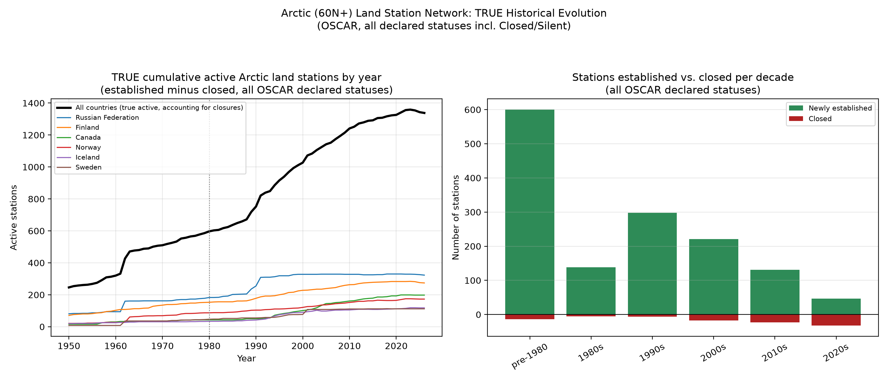

# How Has the Arctic Station Network Evolved from the 1980s to Now?

**Revision note:** an earlier version of this report used only the bundled
[oscar_arctic_stations_60n.csv](oscar_arctic_stations_60n.csv) (1,127 records, all
declared "Operational"), which turned out to **undercount the network** and
contained almost no closed stations (1 of 1,127). This revision pulls the complete
OSCAR Surface register — **all declared statuses** (Operational, Closed, Silent,
Partly operational, Unknown) — directly from the public OSCAR API, which both
corrects the undercount and finally allows a **true** historical active-count
series instead of a "today's survivors only" one.

## What changed and why

Querying `https://oscar.wmo.int/surface/rest/api/search/station` with
`latitudeMin=60&latitudeMax=90&longitudeMin=-180&longitudeMax=180` returns **every**
station OSCAR has ever registered in the box, regardless of current status —
1,621 land stations (`Land (fixed)` + `Land (on ice)`, 14 Bosnia-and-Herzegovina
test records excluded as before) versus the 1,113 in the old operational-only
export. Comparing the two **for currently-Operational stations only** shows the
old bundled CSV was itself substantially incomplete, not just missing closures:

| Country | Old bundled CSV (Operational only) | Comprehensive OSCAR pull (Operational only) | Undercount |
|---|---|---|---|
| Finland | 170 | 282 | -40% |
| Norway | 149 | 240 | -38% |
| Greenland | 44 | 82 | -46% |
| Sweden | 88 | 137 | -36% |
| Canada | 162 | 211 | -23% |
| United States | 51 | 59 | -14% |
| Iceland | 107 | 119 | -10% |
| Russian Federation | 330 | 356 | -7% |

This means **every prior report in this folder that used the bundled CSV
understated the size of the Arctic land network**, in some countries by close to
half. The new dataset —
[oscar_arctic_land_stations_allstatus_60n.csv](oscar_arctic_land_stations_allstatus_60n.csv)
(1,621 records: 1,505 Operational, 91 Closed, 16 Silent, 6 Unknown, 3 Partly
operational) — supersedes the old CSV for all evolution/historical analysis below.
Land-station date quality is good: only 186 of 1,621 (11.5%) lack an establishment
date, and only 1 of 91 closed stations has an implausible closed-before-established
date — so, unlike the mobile marine platforms discussed in the companion
[marine registry report](ARCTIC_MARINE_OSCAR_REGISTRY.md), these dates can be
trusted for a genuine time series.

## Headline answer, corrected

Using actual establishment **and** closure dates, the true count of Arctic land
stations active in any given year was:

| Year | True active stations |
|---|---|
| 1950 | 246 |
| 1960 | 320 |
| 1970 | 510 |
| **1980** | **597** |
| 1990 | 752 |
| 2000 | 1,027 |
| 2010 | 1,241 |
| 2020 | 1,326 |
| **2026** | **1,338** |

So the network has grown **124%** since 1980 (597 → 1,338) — still substantial
growth, but on a different base and with a materially different shape than the
"today's survivors" version of this report showed. Two new findings only visible
once closures are included:

1. **Closures have accelerated sharply.** Pre-1980, essentially nothing closed (14
   stations over ~200 years of records). Since the 2000s, closures have climbed
   every decade: 17 in the 2000s, 23 in the 2010s, and already **32 in the 2020s**
   (with the decade not yet over) — more closures in six years than in the entire
   20th century combined.
2. **Net growth has been shrinking every decade**, and the 2020s are on pace to be
   the first decade with little-to-no net growth, or possibly a net decline:

| Decade | Established | Closed | Net change | Cumulative true-active |
|---|---|---|---|---|
| pre-1980 | 600 | 14 | +586 | 586 |
| 1980s | 138 | 5 | +133 | 719 |
| 1990s | 298 | 6 | +292 | 1,011 |
| 2000s | 221 | 17 | +204 | 1,215 |
| 2010s | 131 | 23 | +108 | 1,323 |
| 2020s (through 2026) | 47 | 32 | **+15** | 1,338 |

Full table: [oscar_arctic_land_stations_by_decade_allstatus.csv](oscar_arctic_land_stations_by_decade_allstatus.csv)

The true cumulative curve actually **peaks around 2020–2022 and ticks down
slightly toward 2026** (visible in the chart below) — the first sustained
flattening/reversal in the network's history. This lines up with, and gives a
second independent line of evidence for, the real-time ECMWF observation-count
declines discussed in the companion
[marine observations report](ARCTIC_MARINE_OBSERVATIONS_AND_SHIP_DATA.md): it's not
only that fewer of the registered stations are delivering usable real-time data —
the underlying land-station count itself has stopped growing and shows early signs
of net attrition.

## Country breakdown: 1980 vs. today (true active counts, closures included)

| Country | True active, 1980 | True active, 2026 | Growth |
|---|---|---|---|
| Russian Federation | 183 | 323 | +77% |
| Finland | 153 | 274 | +79% |
| Canada | 43 | 198 | +360% |
| Norway | 87 | 173 | +99% |
| Iceland | 34 | 118 | +247% |
| Sweden | 47 | 112 | +138% |

Compared to the earlier (undercounted, survivorship-biased) version of this
analysis, Russia's and Finland's growth rates are now much higher once their true
1980 base and real closures are accounted for — the earlier report's claim that
Russia had "no new OSCAR registrations since the 1990s" was an artifact of the
incomplete bundled CSV, not a real pattern; the comprehensive data shows closures,
not an establishment freeze, dominating Russia's recent numbers.

## Has the High Arctic (≥70°N) gap persisted?

Yes, this conclusion is unchanged and now confirmed on a more complete dataset: the
share of true-active land stations at ≥70°N has stayed in a narrow 9.2–12.0% band
every decade since before 1980:

| By end of decade | True-active total | True-active ≥70°N | Share ≥70°N |
|---|---|---|---|
| pre-1980 | 586 | 54 | 9.2% |
| 1980s | 719 | 71 | 9.9% |
| 1990s | 1,011 | 95 | 9.4% |
| 2000s | 1,215 | 118 | 9.7% |
| 2010s | 1,323 | 148 | 11.2% |
| 2020s | 1,338 | 161 | 12.0% |

## Visualization

Left panel: true cumulative active station count by year (established minus
closed), all countries and the six largest contributors, with 1980 marked. Right
panel: stations established (green, above zero) vs. closed (red, below zero) per
decade — note closures growing every decade since the 2000s while new
establishments shrink.

## Data files

- [oscar_arctic_land_stations_allstatus_60n.csv](oscar_arctic_land_stations_allstatus_60n.csv) —
  all 1,621 land stations (any declared status), pulled directly from the OSCAR API.
- [oscar_arctic_land_stations_by_decade_allstatus.csv](oscar_arctic_land_stations_by_decade_allstatus.csv) —
  established/closed/net/cumulative counts per decade.
- [oscar_arctic_land_stations_true_evolution.png](oscar_arctic_land_stations_true_evolution.png) —
  the figure above.

For the marine/ocean side of OSCAR's Arctic register (ships, drifting ice buoys,
Argo floats), see [ARCTIC_MARINE_OSCAR_REGISTRY.md](ARCTIC_MARINE_OSCAR_REGISTRY.md).

## Remaining caveats

- 186 of 1,621 land stations (11.5%) still lack an establishment date and are
  excluded from the time series, which slightly understates every cumulative
  figure above (consistently across time, so decade-to-decade comparisons should
  still be valid).
- "Closed" and "Silent" are both OSCAR-declared statuses set by national focal
  points on their own schedule; a station can sit in an intermediate,
  not-yet-updated state for a while after it actually stops reporting, so recent
  years' closure counts may still rise further as records catch up — meaning the
  2020s closure total of 32 is likely an undercount of the true number, not an
  overcount.
- This is still a single API snapshot (taken 2026), not an audited longitudinal
  register; OSCAR records can be corrected or backdated, which would shift exact
  per-year counts without necessarily changing the overall shape of the trend.
